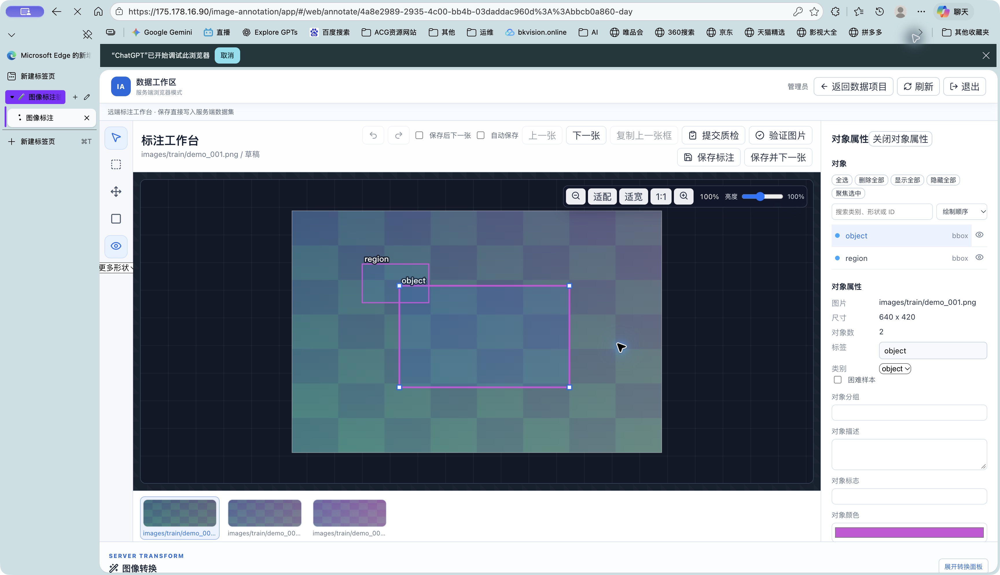
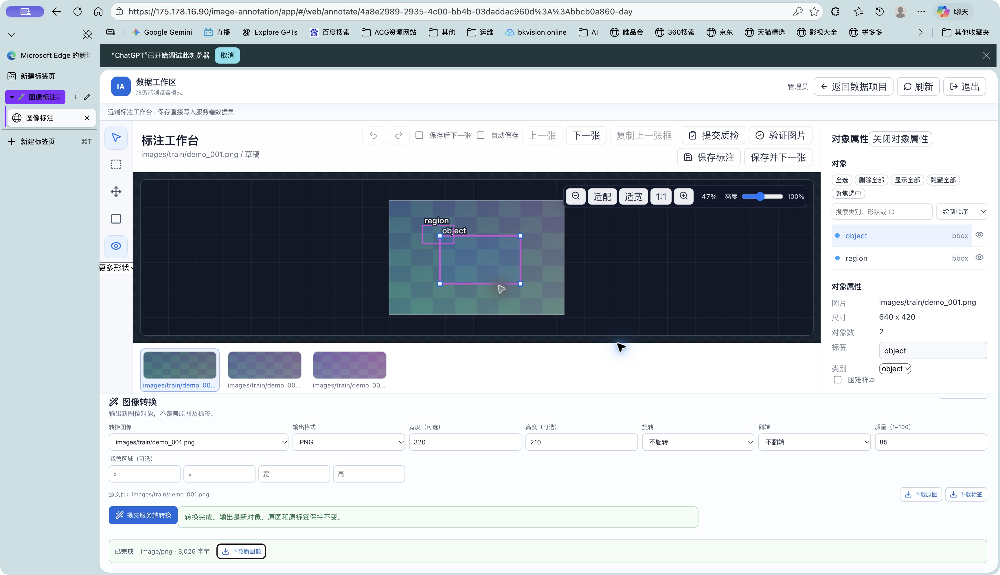

# Web 工作区最终验收

已完成实现并发布到现有云服务：[打开正式网页版](https://175.178.16.90/image-annotation/app/)。Web 数据库位于服务端 PostgreSQL，图像和不可变对象位于服务端 S3。桌面安装包与 Web 分别验收。

## 已验证的功能

一个检测数据项目管理多个数据集；原图、标签、处理状态、分支、双父合并与显式冲突选择、保留历史的版本回退均已通过真实服务验证。桌面来源的数据集可以直接在 Web 打开、上传新图像和继续标注；这些变更能够被真实 Rust 桌面客户端克隆读取。

服务端支持 JPEG、PNG、WebP、TIFF 转换，以及裁剪、缩放、旋转、翻转和适用格式的质量设置。输出保存为新对象，原图和原标签保持不变；任务及下载历史在服务重启后仍可恢复。

## 验证结果

| 范围 | 通过数量 | 证据 |
| --- | ---: | --- |
| 前端 Vitest / Chrome 壳测试 | 237 / 12 | 当前源码完整测试 |
| 服务端 Rust 单元测试 / 真实 PostgreSQL 集成 | 29 / 11 | server-unit.log / postgres-integration.log |
| 正式 Web 项目完整操作 | 34 | [报告](production-web-workspace.json) |
| 正式服务端图像转换及字节校验 | 43 | [报告](production-image-transforms.json) |
| 正式原生云协议兼容性 | 30 | [报告](production-native-cloud.json) |
| 正式 Edge 登录、画布、转换和实际下载 | 9 | [报告](production-browser.json) |
| 桌面来源数据集在正式 Web 中的可见性 | 3 | [报告](production-native-virtual-datasets.json) |
| 隔离服务重启后的项目 / 转换恢复 | 8 / 3 | [项目](staging-web-restart.json) / [转换](staging-transform-restart.json) |
| 原生来源数据集新增图像、分支和桌面回读 | 9 | [报告](staging-native-virtual-datasets.json) |
| 移出唯一数据集、历史保留与分支删除 | 5 | [报告](staging-membership-and-delete.json) |

正式浏览器下载的 PNG 为 320×210、3,026 字节，SHA-256 与服务端任务一致。原桌面验收项目 HEAD b6290a98 和干净工作区保持不变。Cookie 过期后的自动刷新及刷新失败清理状态也已验证。

## 发布与数据保护

[最终部署回执](deployment-receipt.json)记录运行中二进制、源码和 Web 资源哈希；[最终汇总](final-validation.json)关联完整验收证据。数据库与旧程序已备份，原有 5,774 个对象的 key、大小和 ETag 均未变化，见[对象完整性](production-existing-object-integrity.json)。迁移 0005–0008 为增量迁移，未改写已应用的迁移校验。

[桌面独立验收](../2026-10-26-data-projects/final-validation.json)及[桌面包回执](../2026-10-26-data-projects/package-receipt.json)单独保留；验收应用和交付应用的代码及嵌入前端节内容一致。桌面包为本机 macOS arm64 ad-hoc 签名验收包。

Web 当前提供服务端生成的 JSON 项目清单和原图/标签逐项下载；整包导入导出与本地 AI 保留在桌面流程。构建和使用方法见 [Web 工作区说明](../../web-workspace.md)。历史失败报告和修复前截图用于复核，不计入最终通过结果。

## 正式界面

